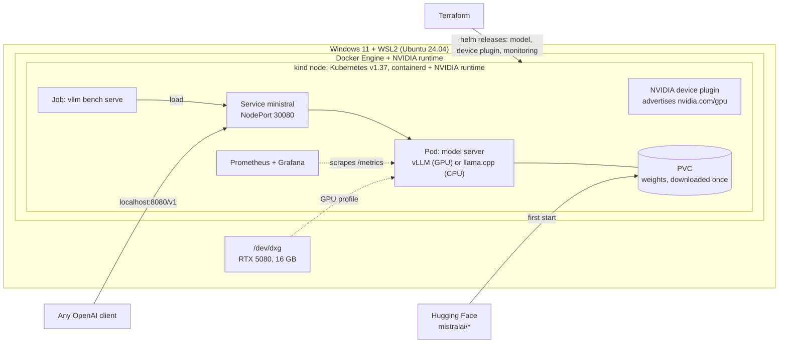

# mistral-k8s

Serving Mistral's **Ministral 3** models on Kubernetes, end to end, on a single workstation:
- a GPU profile with **vLLM** (FP8 weights) and a CPU profile with **llama.cpp** (GGUF Q4);
- packaged as a **Helm** chart and deployed with **Terraform** on a local **kind** cluster under WSL2;
- observed with **Prometheus + Grafana**, load-tested in-cluster, with a **CI** workflow (static checks + e2e on kind).


**Ministral 3 3B on one RTX 5080, served from a Kubernetes pod:**
- **~3,000 output tokens/s** at 32 concurrent requests, with a time to first token (TTFT) p95 of 310 ms;
- 163 tokens/s for a single request;
- 0 failures out of 512 requests.

See [Results](#results).

This is a learning project. I built it to learn Kubernetes hands-on, working agent-first with Claude Code, and kept the
whole path in [`docs/learning/`](docs/learning/README.md) (in French): commands, real outputs, concepts and interview
questions for each step. It is a single-node local setup, not a production platform; the
[design decisions](docs/decisions.md) say what would change on a real cluster.

## What it covers

| Area | In this repo |
|---|---|
| Containers and GPU | Docker Engine + NVIDIA Container Toolkit on WSL2; the GPU passed through **two runtimes** (Docker → kind node → containerd → pod) |
| Kubernetes | Deployment, Service, PVC, startup/readiness/liveness probes sized for multi-minute model loads, `Recreate` strategy, NVIDIA device plugin (WSL2 mode), `nvidia.com/gpu` scheduling |
| Packaging and IaC | Helm chart with CPU / GPU / CI values; Terraform with a `profile` variable, pinned providers, `plan -out` → `apply` |
| Model serving | vLLM v0.32.0 (FP8, paged KV cache, continuous batching, OpenAI-compatible API) and llama.cpp (GGUF Q4) behind the same chart |
| Observability | kube-prometheus-stack, a ServiceMonitor rendered only when its CRD exists, and a 10-panel Grafana dashboard built from vLLM's live `/metrics` |
| Performance | `vllm bench serve` as an in-cluster Job, at concurrency 1 to 32, with raw JSON results committed |
| CI | shellcheck, helm lint, kubeconform (Kubernetes 1.37 schemas), terraform validate, then an e2e deploy on kind and a real chat completion (static checks verified locally; first hosted run pending) |
| Supply chain | pinned tool versions with checksum verification, images pinned by tag or digest, provider lock file |

## Architecture



## Quick start

CPU profile (any Linux or WSL2 machine with Docker):

```bash
sudo bash scripts/setup-wsl.sh              # Docker Engine + NVIDIA Container Toolkit (once)
bash scripts/install-tools.sh               # kind, kubectl, helm, terraform, kubeconform: pinned + checksum-verified
kind create cluster --config kind/cluster.yaml
cd terraform && terraform init && terraform plan -out=tfplan && terraform apply tfplan
curl -s localhost:8080/v1/chat/completions -H 'Content-Type: application/json' \
  -d '{"messages":[{"role":"user","content":"Explain Kubernetes in two sentences."}],"max_tokens":120}'
```

GPU profile (NVIDIA GPU; tested on WSL2):

```bash
sudo bash scripts/setup-gpu-host.sh                      # NVIDIA as Docker's default runtime (once)
kind create cluster --config kind/cluster-gpu.yaml       # the node receives the GPU through a mount trigger
bash scripts/setup-kind-gpu-node.sh                      # NVIDIA runtime for containerd inside the node
bash scripts/load-image-into-kind.sh vllm/vllm-openai:v0.32.0
cd terraform && terraform plan -var profile=gpu -var monitoring=true -out=tfplan && terraform apply tfplan
bash bench/run.sh                                        # load test, results in bench/results/<date>/
kubectl -n monitoring port-forward svc/monitoring-grafana 3300:80   # dashboard "vLLM: Ministral serving"
```

## Results

Ministral 3 3B Instruct (2512) on an RTX 5080. ~4 GB of its 16 GB is held by the Windows desktop, and vLLM gets
`--gpu-memory-utilization 0.6` and an 8k context.

**Load test** ([raw results](bench/results/2026-11-13/), [method](docs/learning/07-observabilite-load-test.md)):
- random 512-token prompts and exactly 256 output tokens;
- fixed seed, 4 warm-up requests excluded;
- run in-cluster against the Service.

| Concurrency | Requests (failed) | Output tok/s | Req/s | TTFT p50 / p95 (ms) | TPOT p50 / p95 (ms) | E2E p95 (s) |
|---:|---:|---:|---:|---:|---:|---:|
| 1 | 32 (0) | 163 | 0.64 | 22 / 24 | 6.0 / 6.4 | 1.6 |
| 4 | 32 (0) | 582 | 2.27 | 23 / 30 | 6.8 / 7.0 | 1.8 |
| 8 | 64 (0) | 1099 | 4.29 | 51 / 110 | 7.0 / 7.4 | 2.0 |
| 16 | 128 (0) | 1886 | 7.37 | 112 / 189 | 8.0 / 8.4 | 2.2 |
| 32 | 256 (0) | 2987 | 11.67 | 142 / 310 | 10.2 / 10.6 | 2.8 |

**What the numbers show:**
- **Throughput:** continuous batching multiplies total throughput by 18× from 1 to 32 concurrent requests.
- **Per-request speed:** each request only goes from ~166 to ~98 tokens/s (TPOT 6.0 → 10.2 ms).
- **TTFT** is what degrades most (p95 24 → 310 ms) as new prompts wait for their prefill.
- **Headroom:** measured in Prometheus over the run, with 0 preemptions, the KV cache peaked at 49% and queue time p99
  was ≈ 0.3 s. The ceiling is above 32 concurrent requests. Sizing a deployment means
  picking the point on this curve that meets a latency target.

**Serving profiles:**

| | GPU: vLLM v0.32.0, FP8 | CPU: llama.cpp, Q4_K_M, 4 threads |
|---|---|---|
| Weights in memory | 4.47 GiB (loaded in 48 s) | 2.1 GB |
| KV cache | 4.01 GiB = 40,384 tokens | 4 slots × 4,096 tokens |
| Cold start | engine ready after 150 s (profiling, compilation, CUDA graphs) | pod Ready in ~50 s, 2.1 GB download included |
| One request, same question | 113 tokens in 0.89 s end to end | 104 tokens in ~10.7 s (generation ~19 tok/s) |

One finding worth knowing before you deploy:
- **What happens:** when the client sends no system prompt, the GGUF chat template injects Mistral's default one
  (~530 tokens).
- **What it costs:** on CPU, ~5 s before the first token of a 10-token question.
- **vLLM:** with `--tokenizer-mode mistral`, it does not inject it, but it defaults to temperature 1.0. The GPU profile
  sets 0.1 server-side, as the model card recommends.

Details in [step 4](docs/learning/04-premier-deploiement.md).

## Repository layout

```
├── scripts/            host setup (Docker, NVIDIA toolkit), pinned tool install, GPU node setup, image loading
├── kind/               cluster definitions: CPU, and GPU (mount trigger for the NVIDIA runtime)
├── k8s/manual/         the first deployment, written by hand (kept for learning)
├── charts/ministral/   Helm chart: Deployment, Service, PVC, probes, ServiceMonitor; CPU, GPU and CI values
├── terraform/          namespace, model release, device plugin + node label (gpu), monitoring (optional)
├── observability/      kube-prometheus-stack values, Grafana dashboard
├── bench/              load-test Job, runner, summarizer, raw results
├── .github/workflows/  CI: static checks, then e2e on kind
└── docs/
    ├── decisions.md    design decisions and what would change in production
    └── learning/       step-by-step learning path (FR): commands, real outputs, concepts, interview questions
```

## Roadmap

- [x] **A.** GPU in Docker on WSL2 (native Docker Engine, not Docker Desktop)
- [x] **B.** vLLM + Ministral 3 3B FP8 in plain Docker, memory profile recorded
- [x] **C.** kind cluster, first deployment by hand: Namespace, PVC, Deployment, Service, probes
- [x] **D.** Helm chart + Terraform (`plan -out` / `apply`)
- [x] **E.** GPU in the cluster: NVIDIA runtime in the kind node, device plugin (WSL2 mode), vLLM profile
- [x] **F.** Prometheus + Grafana, in-cluster load test
- [ ] **F'.** CI: workflow written, static checks pass locally; first green hosted run pending
- [ ] **Next.** The same Terraform on a managed cluster with GPU nodes (OVHcloud Managed Kubernetes); autoscaling on
  queue depth; Ministral 3 8B; prefix caching for shared system prompts

## License

Code: MIT. Models: Ministral 3 weights are Apache 2.0, downloaded from Hugging Face at runtime, never stored here.
