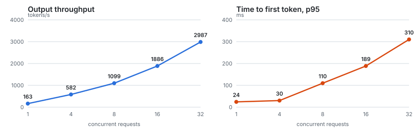
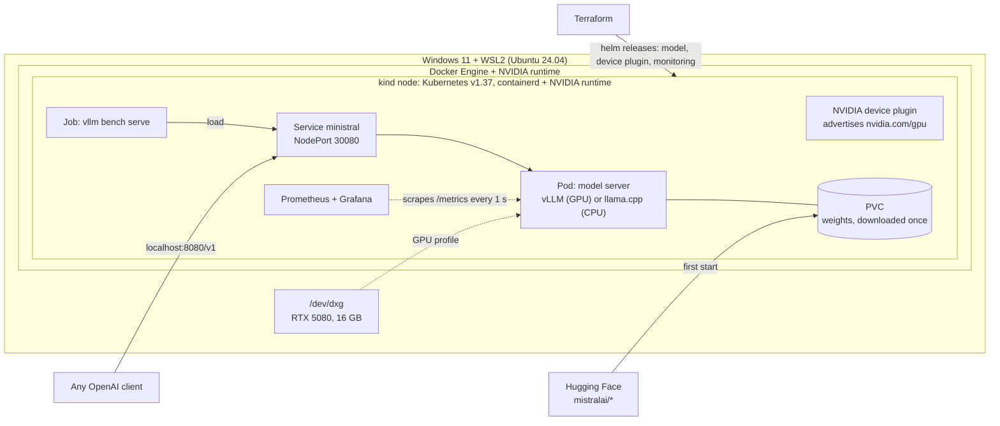
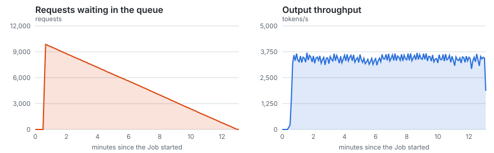
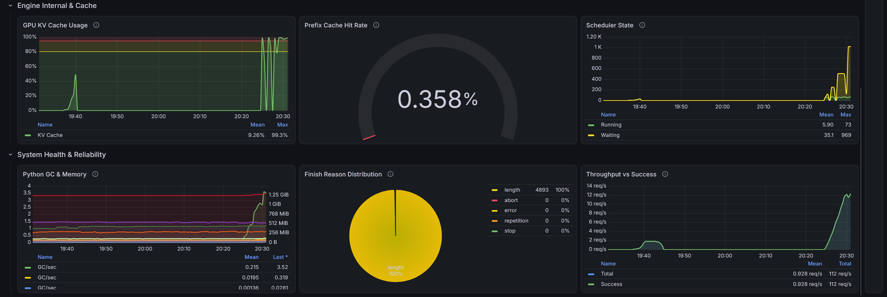
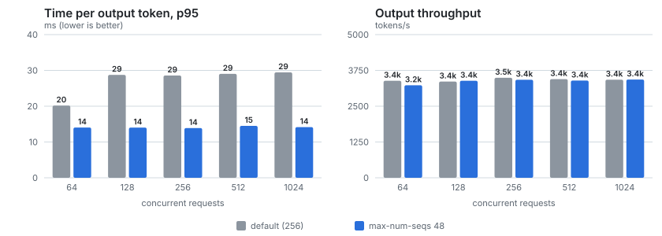
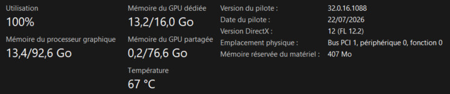

# Mistral on Kubernetes

[](https://github.com/axsxyz/mistral-k8s/actions/workflows/ci.yml)

Ministral 3 served on Kubernetes: vLLM on GPU and llama.cpp on CPU, Helm + Terraform, Prometheus/Grafana, in-cluster load tests and tuning.



## Problem

Serving an open-weight model in production is mostly an infrastructure problem:
- **The GPU** has to reach a container through the driver, the container runtime and Kubernetes' device plugin.
- **Cold starts are slow.** A model server is not ready for minutes: here, 48 s to load the weights, then 150 s of
  engine profiling and CUDA graph capture.
- **The artifacts are heavy.** The inference image is 33 GB and the weights several GB.
- **Sizing is a latency trade-off,** decided by the KV cache rather than by CPU or RAM.

I had never used Kubernetes. I built this to learn it on that problem, end to end, on one workstation (RTX 5080, WSL2):
- deploy Mistral's Ministral 3 3B the way a customer deployment would be, from code (Helm + Terraform);
- observe it;
- load it until it saturates;
- tune it from measurements.

The whole path is written up in [`docs/learning/`](docs/learning/README.md) (in French): one fiche per step, with the
commands, the real outputs, the concepts and interview questions.

It is a single-node local setup, not a production platform. [`docs/decisions.md`](docs/decisions.md) says what would
change on a real cluster.

## Architecture



**Host** (`scripts/`):
- `setup-wsl.sh` installs Docker Engine and the NVIDIA Container Toolkit.
- `install-tools.sh` installs kind, kubectl, helm, terraform and kubeconform at pinned versions, each checked against
  its project's published SHA-256.

**GPU path** (`kind/cluster-gpu.yaml`, `scripts/setup-gpu-host.sh`, `scripts/setup-kind-gpu-node.sh`):
- **Host:** Docker's default runtime is NVIDIA's.
- **kind node:** it mounts `/dev/null` on `/var/run/nvidia-container-devices/all`, which the NVIDIA runtime reads as
  "give this container every GPU" (the nvkind method).
- **Inside the node:** containerd gets the NVIDIA runtime too.
- **Scheduling:** the NVIDIA device plugin v0.20.1 advertises `nvidia.com/gpu` (WSL2 mode, one "all" device backed by
  `/dev/dxg`).

**Model server** (`charts/ministral/`): one Helm chart, three values files.
- `values.yaml`, the default CPU profile: llama.cpp with Mistral's GGUF Q4_K_M.
- `values-gpu.yaml`: vLLM v0.32.0 with the FP8 weights, `nvidia.com/gpu: 1`, an in-memory `/dev/shm`, and
  `--max-num-seqs 48`.
- `values-ci.yaml`: sized for GitHub runners.
- **Templates:** Deployment (`Recreate`; startup/readiness/liveness probes sized for multi-minute loads), NodePort
  Service, a PVC kept on uninstall, and a ServiceMonitor rendered only when its CRD exists.

**Infrastructure as code** (`terraform/`):
- the namespace and the model release, with a `profile` variable (`cpu` | `gpu`);
- on `gpu`: the node label and the device plugin release;
- with `monitoring = true`: kube-prometheus-stack and the dashboard ConfigMap.

**Observability** (`observability/`):
- Prometheus scrapes vLLM every second.
- A 10-panel Grafana dashboard, built from the metrics vLLM v0.32.0 actually exposes: throughput, TTFT, inter-token
  latency, queue, KV cache, preemptions.

**Load tests** (`bench/`):
- `vllm bench serve` runs as an in-cluster Job, closed loop at a given concurrency or as an open-loop burst.
- `server-metrics.sh` pulls the server-side view from Prometheus over the Job's exact window.
- `summarize.py`, `compare.py` and `timeline.py` render the tables and charts from the committed raw JSON.

## Results

Ministral 3 3B Instruct (2512) on one RTX 5080. The Windows desktop holds ~4 GB of its 16 GB, so vLLM runs with
`--gpu-memory-utilization 0.6` and an 8k context. Every run uses random 512-token prompts and exactly 256 output
tokens, a fixed seed and 4 excluded warm-ups, sent in-cluster against the Service. Raw results are in
[`bench/results/`](bench/results/).

**Baseline, 1 to 32 concurrent requests** (vLLM defaults; the later `--max-num-seqs 48` does not bind below 48):

| Concurrency | Requests (failed) | Output tok/s | TTFT p50 / p95 (ms) | TPOT p50 / p95 (ms) | E2E p95 (s) |
|---:|---:|---:|---:|---:|---:|
| 1 | 32 (0) | 163 | 22 / 24 | 6.0 / 6.4 | 1.6 |
| 4 | 32 (0) | 582 | 23 / 30 | 6.8 / 7.0 | 1.8 |
| 8 | 64 (0) | 1099 | 51 / 110 | 7.0 / 7.4 | 2.0 |
| 16 | 128 (0) | 1886 | 112 / 189 | 8.0 / 8.4 | 2.2 |
| 32 | 256 (0) | 2987 | 142 / 310 | 10.2 / 10.6 | 2.8 |

- **Throughput:** continuous batching multiplies it by 18× from 1 to 32 concurrent requests.
- **Per-request speed:** each request only drops from ~166 to ~98 tokens/s.

**Saturation, 64 to 1,024 concurrent requests:**
- Throughput plateaus at **~3,400 tokens/s**.
- Time to first token grows with the queue as Little's law predicts: 1,024 ÷ 13.4 req/s ≈ 76 s, and E2E p50 measured
  75 s.
- **0 failures out of 7,936 requests.**

**A burst of 10,000 requests at once:**
- **All succeeded.** The queue peaked at 9,852 and drained linearly in 12.7 minutes, at the same ~3,400 tokens/s.
- **Robust, but not sized for that peak:** median time to first token was 6.4 minutes.



**CPU profile:** llama.cpp Q4_K_M on 4 threads generates ~19 tokens/s for a single request.

Fiches [7](docs/learning/07-observabilite-load-test.md) and [9](docs/learning/09-stress-test-reglage.md) have the
full tables and the method.

## Technical choices and trade-offs

**1. kind, with the GPU passed through two container runtimes.**
- *Why:* a real Kubernetes API on one machine, recreated in a minute, and the same cluster type the CI uses.
- *Cost:* the GPU path needs NVIDIA as Docker's default runtime plus a mount trigger on the node. Node mounts cannot
  be added to a running cluster, so adding the GPU meant recreating it (Terraform rebuilt everything in one `apply`).

**2. One chart, two serving profiles.**
- *Why:*
  - **GPU, vLLM:** vLLM is the server Mistral documents for self-deployment, and Ministral 3 ships FP8 weights, so the
    3B fits in 4.47 GiB.
  - **CPU, llama.cpp:** it runs where there is no GPU, which makes it the profile CI deploys end to end.
- *Cost:* the two servers expose different metric names, so the dashboard covers vLLM only. Values lists (`args`,
  `env`) replace rather than merge, so each profile repeats its full argument list.

**3. Probes sized for model servers.**
- *How:* a startup probe allows 10 minutes (60 × 10 s) and holds the liveness probe back until the server answers
  `/health`.
- *Why:* measured cold start of 48 s of weight loading plus 150 s of engine init. A liveness probe alone would restart
  the container in a loop.
- *Cost:* a server that truly hangs during startup is only restarted after 10 minutes.

**4. Weights on a PVC, `Recreate` strategy.**
- *How:* weights download once into a PersistentVolumeClaim that `helm uninstall` keeps (`helm.sh/resource-policy:
  keep`).
- *Why:* restarts reuse the gigabytes already downloaded, and one GPU cannot hold two vLLM servers during a rolling
  update.
- *Cost:* every rollout is downtime, and `terraform destroy` still deletes the PVC with the namespace.

**5. Terraform drives Helm.**
- *How:* Terraform owns the namespace and the releases, and is always run as `plan -out=tfplan` then
  `apply tfplan`, so what is applied is what was read.
- *Why:* one command rebuilds the whole stack, and drift shows up in the plan (it caught the namespace deleted along
  with an old cluster).
- *Cost:* the Helm provider does not diff local template content. Any chart change needs a `version` bump in
  `Chart.yaml`, or `plan` shows nothing (incident 6).

**6. `--max-num-seqs 48`, computed from the KV cache.**
- *How:* 40,384 tokens ÷ 16 = 2,524 KV blocks, and 48 blocks per 768-token request, so 52 requests fit at full length;
  48 leaves a margin.
- *Why:* vLLM's default for a 16 GB GPU (256) admitted 73 sequences and preempted ~3,000 times (incident 3).
- *Cost:* fewer requests start at once, so time to first token rises at moderate load. The cap is only right for this
  request shape and must be re-derived for real traffic.

**7. Pin everything.**
- *How:* tool versions with checksums; the kind node image by digest; llama.cpp by versioned tag and digest; the vLLM
  image by tag; Terraform providers with a committed lock file.
- *Why:* reproducible rebuilds, locally and in CI.
- *Cost:* the vLLM image is loaded into the node by hand (33 GB, incident 2), so the pod references its tag:
  a manually loaded copy keeps no registry digest.

## What broke and how I fixed it

**1. Docker Desktop would not start** *(host setup)*
- *Symptom:* `mounting vhdx … Wsl/Service/AttachDisk/MountDisk/HCS/E_ACCESSDENIED` on Docker Desktop's data disk.
- *Root cause:* not determined. The file, its ACLs and Defender's folder protection were ruled out. Docker Desktop was
  older (4.43) than the Windows and WSL builds around it.
- *Fix:* switched to native Docker Engine in WSL2. kind's GPU path needs it anyway, to set NVIDIA as the daemon's
  default runtime (`bc9d83d`).

**2. `kind load docker-image` failed on the 33 GB vLLM image** *(GPU in the cluster)*
- *Symptom:* `ctr: content digest sha256:6ff5ff0d…: not found`.
- *Root cause:* Docker 29's containerd image store keeps only the local platform's layers of a multi-platform image,
  while kind imports with `--all-platforms`.
- *Fix:* `scripts/load-image-into-kind.sh` exports `linux/amd64` only and imports it straight into the node's
  containerd. It took 3 min 36 s (`076b620`).

**3. ~3,000 preemptions and a ragged token stream under load** *(stress test)*
- *Symptom:* at 64 to 1,024 concurrent requests, TPOT p95 was 29 ms against 17 ms p50, and Prometheus counted 2,984
  preemptions. Grafana during that run:

  

  *An imported vLLM dashboard, not the one in this repo. The KV cache sits at 99%, running peaks at 73, and waiting
  at 969.*
- *Root cause:* `max_num_seqs` defaults to 256 on a 16 GB GPU. vLLM admits requests while only their prompts occupy
  the cache, then evicts running ones as they grow.
- *Fix:* `--max-num-seqs 48` (trade-off 6), then the same test with one variable changed. Preemptions went to 0, TPOT
  p95 was halved (29 → 14 ms), throughput was unchanged, and TTFT rose at moderate load (`f7f0f26`):

  

**4. vLLM sampled at temperature 1.0** *(first vLLM run; cause found later)*
- *Symptom:* an artifact in an early answer (`^{[V0-X]}`). The model card recommends a temperature below 0.1.
- *Root cause:* the model's `generation_config.json` sets no temperature, so requests without one get
  `SamplingParams`' default of 1.0. That was checked in the image, and my notes had said 0.8.
- *Fix:* `--override-generation-config '{"temperature": 0.1}'` on the GPU profile; llama.cpp gets `--temp 0.1`
  (`27edc7e`).

**5. A 10-token question cost 543 prompt tokens on CPU** *(first deployment)*
- *Symptom:* ~5 s before the first token on a short question with llama.cpp. vLLM counted 11 prompt tokens for the
  same question.
- *Root cause:* with no system prompt from the client, the GGUF chat template injects Mistral's default one (~2,500
  characters, with a literal `{today}`). vLLM in `mistral` tokenizer mode injects nothing.
- *Fix:* none in the server. It is a trade-off: Mistral recommends that prompt for quality. It is documented, and
  clients that care about latency send their own system prompt (fiche 4).

**6. Chart changes invisible to `terraform plan`, and vLLM restarting for unrelated changes** *(monitoring)*
- *Symptom:* after editing chart templates, `plan` showed no change to the model release. Separately, changing only
  the Prometheus scrape interval restarted vLLM (~4 minutes).
- *Root cause:* the Helm provider compares the chart version and values, not template content. A `checksum/values`
  pod annotation hashed every value, including ones that do not concern the pod.
- *Fix:* chart `version` bumped to 0.2.0, and the annotation removed. Args already live in the pod template, so real
  changes still roll the pod (`4eab214`).

**7. Grafana panels updated every 30 s despite a 1 s scrape** *(monitoring)*
- *Symptom:* Query inspector showed `Step: 30s` with the dashboard refreshing every second.
- *Root cause:* the chart sets the Prometheus datasource's `timeInterval` to Prometheus's default scrape interval
  (30 s), and Grafana never queries with a smaller step.
- *Fix:* `defaultDatasourceScrapeInterval: 1s`, and a 1 s minimum interval on every panel (`33fb526`).

## Getting started

CPU profile (any Linux or WSL2 machine with Docker):

```bash
sudo bash scripts/setup-wsl.sh              # Docker Engine (+ NVIDIA toolkit, checked only if a GPU is present)
bash scripts/install-tools.sh               # kind, kubectl, helm, terraform, kubeconform into ~/.local/bin
kind create cluster --config kind/cluster.yaml
cd terraform && terraform init && terraform plan -out=tfplan && terraform apply tfplan
curl -s localhost:8080/v1/chat/completions -H 'Content-Type: application/json' \
  -d '{"messages":[{"role":"user","content":"Explain Kubernetes in two sentences."}],"max_tokens":120}'
```

GPU profile (NVIDIA GPU; tested on WSL2):

```bash
sudo bash scripts/setup-gpu-host.sh                      # NVIDIA as Docker's default runtime
kind create cluster --config kind/cluster-gpu.yaml
bash scripts/setup-kind-gpu-node.sh                      # NVIDIA runtime for containerd inside the node
bash scripts/load-image-into-kind.sh vllm/vllm-openai:v0.32.0
cd terraform && terraform plan -var profile=gpu -var monitoring=true -out=tfplan && terraform apply tfplan
kubectl -n monitoring port-forward svc/monitoring-grafana 3300:80   # dashboard "vLLM: Ministral serving"
```

## Configuration

Terraform variables (`terraform/variables.tf`); a local, git-ignored `terraform.tfvars` can pin them:

| Variable | Default | Effect |
|---|---|---|
| `profile` | `cpu` | `cpu`: llama.cpp + GGUF Q4. `gpu`: vLLM + FP8, node label and device plugin |
| `monitoring` | `false` | kube-prometheus-stack (Prometheus, Grafana, operator) and the vLLM dashboard |
| `extra_values_files` | `[]` | more values files layered last, e.g. `["../charts/ministral/values-ci.yaml"]` |
| `kube_context` | `kind-mistral` | kubeconfig context of the target cluster |
| `gpu_node` | `mistral-control-plane` | node that receives the GPU label |

Serving parameters live in the chart's values files. Per profile: image, server arguments (context length, GPU memory
share, `--max-num-seqs`, temperature), resources, volume size, probe timings, scrape interval.

## Tests

- **CI** (`.github/workflows/ci.yml`, on every push), about 2.5 minutes:
  - **static checks:** shellcheck; `helm lint` on the three values files; kubeconform in strict mode against the
    Kubernetes 1.37 schemas; `terraform fmt -check` and `validate`;
  - **end to end:** a kind cluster in the runner, `terraform apply` of the CPU profile with CI sizing, then
    `/v1/models` and a real chat completion that must not be empty. Diagnostics are dumped on failure.
- **Load tests:**
  - `bench/run.sh <name> "<levels>" <requests per level unit>`, where a level is a concurrency or `burstN`;
  - results land in `bench/results/<date>-<name>/` with `server-metrics.json` and `timeline.svg` when monitoring is
    on;
  - `bench/compare.py` diffs two runs.
- **No GPU test in CI:** GitHub-hosted runners have no GPU. The GPU profile is validated by the runs above.

## Development workflow

- Built agent-first with Claude Code. I ran the commands myself, step by step, to learn Kubernetes, and the agent
  wrote most of the files under review.
- Each step was validated by its own evidence before moving on, for example `Allocatable: nvidia.com/gpu: 1` before
  deploying vLLM.
- Claims were checked before publishing. A review pass corrected several, including:
  - vLLM's default temperature;
  - the llama.cpp tag scheme;
  - the meaning of `vllm bench`'s "peak concurrent requests";
  - the effect of `terraform destroy` on the PVC.
- `docs/learning/` (French) is the step-by-step record: commands, real outputs, concepts, pitfalls and interview
  questions, plus a 51-term glossary.
- `docs/decisions.md` is the long form of the trade-offs above.

## Status and limitations

Implemented: everything above, on one workstation. CI is green.

Known limitations:
- **Single node, local only.** No ingress, authentication, TLS or multi-replica serving. The Service is a NodePort on
  `localhost`.
- **The GPU path is WSL2-specific:** `/dev/dxg`, and the device plugin's WSL mode, which reports one "all" device. On
  a Linux GPU node it would be the GPU Operator or the toolkit baked into the node image, which I have not run.
- **No autoscaling or admission control.** The burst test shows what is missing: under a 10,000-request peak, nothing
  sheds load or adds replicas.
- **Benchmarks are single runs on a shared GPU** (the desktop holds ~4 GB of VRAM). A repeated level measured −3%
  run-to-run, so differences under ~5% are noise. One request shape only (512 → 256 tokens).

  

- **The dashboard covers vLLM only;** llama.cpp metrics use other names.
- **The vLLM image is loaded into kind by hand** rather than pulled from a registry.
- **Not run on a cloud provider.** Next steps:
  - the same Terraform on a managed cluster with GPU nodes (OVHcloud Managed Kubernetes);
  - autoscaling on `vllm:num_requests_waiting`;
  - Ministral 3 8B;
  - prefix caching for shared system prompts.

## License

MIT, see [LICENSE](LICENSE). Ministral 3 weights are Apache 2.0, downloaded from Hugging Face at runtime and not
stored here.
