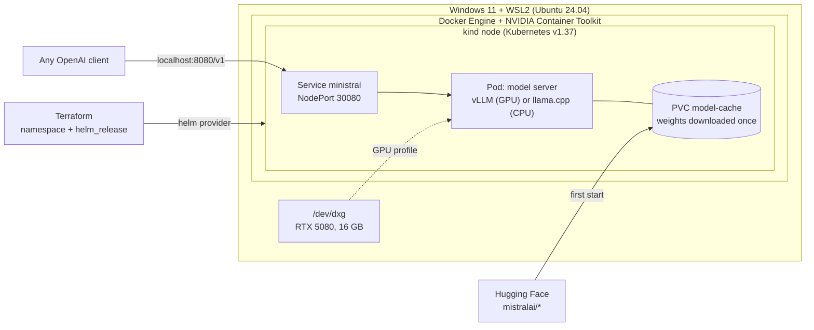

# mistral-k8s

Serving Mistral's **Ministral 3** models on Kubernetes, end to end, on a single workstation: a GPU profile with
**vLLM** (FP8 weights) and a CPU profile with **llama.cpp** (GGUF Q4), packaged as a **Helm** chart and deployed with
**Terraform**, on a local **kind** cluster under WSL2.

> **Status: work in progress.** Steps A to E are done and measured: the GPU profile serves Ministral 3 with vLLM from
> a Kubernetes pod that requests `nvidia.com/gpu: 1`. Observability, load testing and CI (F) are next.
> See [Roadmap](#roadmap).

This is a learning project: I built it to learn Kubernetes hands-on, working agent-first with Claude Code, and kept the
whole path in [`docs/learning/`](docs/learning/README.md) (in French). It is a single-node local setup, not a production
platform; the [design decisions](docs/decisions.md) say what would change on a real cluster.

## Architecture



## Quick start

```bash
sudo bash scripts/setup-wsl.sh              # Docker Engine + NVIDIA Container Toolkit (once)
bash scripts/install-tools.sh               # kind, kubectl, helm, terraform: pinned + checksum-verified
kind create cluster --config kind/cluster.yaml
cd terraform && terraform init && terraform plan -out=tfplan && terraform apply tfplan
curl -s localhost:8080/v1/chat/completions -H 'Content-Type: application/json' \
  -d '{"messages":[{"role":"user","content":"Explain Kubernetes in two sentences."}],"max_tokens":120}'
```

The default profile is CPU. For the GPU profile, the cluster and its node need the NVIDIA runtime first:

```bash
sudo bash scripts/setup-gpu-host.sh                      # NVIDIA as Docker's default runtime (once)
kind create cluster --config kind/cluster-gpu.yaml       # node receives the GPU through a mount trigger
bash scripts/setup-kind-gpu-node.sh                      # NVIDIA runtime for containerd inside the node
bash scripts/load-image-into-kind.sh vllm/vllm-openai:v0.32.0
cd terraform && terraform plan -var profile=gpu -out=tfplan && terraform apply tfplan
```

The GPU profile also installs the NVIDIA device plugin (v0.20.1, WSL2 mode) and labels the node.

## Measured so far

Ministral 3 3B Instruct (2512), on an RTX 5080 (16 GB, ~4 GB of it held by the Windows desktop) and 4 CPU threads, both
served from Kubernetes.

| | GPU: vLLM v0.32.0, FP8 | CPU: llama.cpp, Q4_K_M |
|---|---|---|
| Weights in memory | 4.47 GiB (loaded in 48 s) | 2.1 GB |
| KV cache | 4.01 GiB = 40,384 tokens, 4.9 concurrent requests at 8k context | 4 slots × 4,096 tokens |
| Cold start | engine ready after 150 s of profiling, compilation and CUDA graph capture | pod Ready in ~50 s, including the 2.1 GB download |
| One request, same question | **113 tokens in 0.89 s end to end (~127 tokens/s)** | 104 tokens in ~10.7 s (prefill ~104 tok/s, generation ~19 tok/s) |
| Under concurrent load | to measure (step F) | to measure (step F) |

The GPU numbers match a plain `docker run` of the same server (step B): Kubernetes adds no overhead on the GPU path.

One finding worth knowing before you deploy: when the client sends no system prompt, the GGUF chat template injects
Mistral's default one (~530 tokens). On CPU that costs ~5 s before the first token on a 10-token question. vLLM with
`--tokenizer-mode mistral` does not inject it. Details in [step 4](docs/learning/04-premier-deploiement.md).

## Repository layout

```
├── scripts/            host setup (Docker, NVIDIA toolkit), tool install, plain-Docker vLLM run
├── kind/               cluster definitions: CPU, and GPU (mount trigger for the NVIDIA runtime)
├── k8s/manual/         the first deployment, written by hand (kept for learning)
├── charts/ministral/   Helm chart: Deployment, Service, PVC, probes; CPU defaults, GPU overlay
├── terraform/          namespace + Helm release, with a cpu|gpu profile variable
└── docs/
    ├── decisions.md    design decisions and what would change in production
    └── learning/       step-by-step learning path (FR): commands, real outputs, concepts, interview questions
```

## Roadmap

- [x] **A.** GPU in Docker on WSL2 (native Docker Engine, not Docker Desktop)
- [x] **B.** vLLM + Ministral 3 3B FP8 in plain Docker, memory profile recorded
- [x] **C.** kind cluster, first deployment by hand: Namespace, PVC, Deployment, Service, probes
- [x] **D.** Helm chart + Terraform (`plan -out` / `apply`)
- [x] **E.** GPU in the cluster: NVIDIA runtime in the kind node, device plugin (WSL2 mode), vLLM profile
- [ ] **F.** Prometheus + Grafana on the servers' `/metrics`, load test (TTFT, tokens/s), CI (lint, validate, kind smoke test)

## License

Code: MIT. Models: Ministral 3 weights are Apache 2.0, downloaded from Hugging Face at runtime, never stored here.
