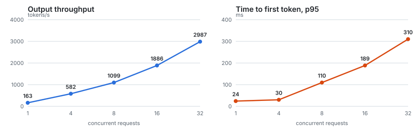

# 7. Observabilité et load test

## Objectif

1. Voir le serveur de modèle de l'intérieur : débit, latences, file d'attente, KV cache.
2. Mesurer son comportement **sous charge**, avec des chiffres reproductibles et leur source.

## Prometheus et Grafana

```bash
# terraform.tfvars (local, hors de git) : profile = "gpu", monitoring = true
cd terraform && terraform plan -out=tfplan && terraform apply tfplan
kubectl -n monitoring get secret monitoring-grafana -o jsonpath='{.data.admin-password}' | base64 -d; echo
kubectl -n monitoring port-forward svc/monitoring-grafana 3300:80     # puis http://localhost:3300
```

**Ce qui est installé :**

| Élément | Rôle |
|---|---|
| `kube-prometheus-stack` 92.16.1 | Prometheus Operator, Prometheus, Grafana, kube-state-metrics, node-exporter (sans Alertmanager) |
| `templates/servicemonitor.yaml` | dit à Prometheus : « lis `/metrics` sur le port `http` des pods de ce Service, toutes les 15 s » |
| `observability/vllm-dashboard.json` | mon tableau de bord, en ConfigMap avec le label `grafana_dashboard=1` |

**Vérifications :**

```
Prometheus, cible ministral : up
vllm:kv_cache_usage_perc{model_name="mistralai/Ministral-3-3B-Instruct-2512", pod="ministral-..."} 0
grafana-sc-dashboard : Writing /tmp/dashboards/vllm-dashboard.json
```

**Le tableau de bord (10 panneaux) :**

- **Indicateurs instantanés :** débit de génération, TTFT p95, requêtes en cours, remplissage du KV cache.
- **Courbes :**
  - tokens/s (génération et prefill) ;
  - requêtes en cours, en attente et terminées ;
  - TTFT p50/p95/p99 ;
  - latence entre tokens ;
  - latence de bout en bout ;
  - temps en file d'attente, KV cache et préemptions.

Je l'ai construit à partir de la **liste réelle** des métriques exposées par le pod
(`kubectl exec … curl localhost:8000/metrics`), pas de mémoire.

## Le load test

```bash
bash bench/run.sh
```

- **Le mécanisme :**
  - `bench/job.yaml` est un **Job Kubernetes**. Il lance `vllm bench serve`, déjà présent dans l'image vLLM chargée
    sur le nœud, et vise le Service (`http://ministral.mistral.svc:80`) depuis l'intérieur du cluster.
  - `bench/run.sh` récupère un JSON brut par palier dans `bench/results/<date>/`, puis `summarize.py` produit le
    tableau et le graphique.
- **Les conditions de mesure :**
  - prompts aléatoires de 512 tokens, sorties forcées à exactement 256 tokens (`--ignore-eos`) ;
  - graine fixe, 4 requêtes d'échauffement exclues ;
  - 8 requêtes par niveau de concurrence, avec un minimum de 32.
- **Le contexte matériel :** RTX 5080 dont ~4 Go sont pris par l'affichage Windows, un seul nœud, contexte limité à
  8 192 tokens, `--gpu-memory-utilization 0.6`.

**Résultats (0 échec sur 512 requêtes) :**

| Concurrence | Requêtes | Tokens/s en sortie | Req/s | TTFT p50 / p95 (ms) | TPOT p50 / p95 (ms) | E2E p95 (s) |
|---:|---:|---:|---:|---:|---:|---:|
| 1 | 32 | 163 | 0,64 | 22 / 24 | 6,0 / 6,4 | 1,6 |
| 4 | 32 | 582 | 2,27 | 23 / 30 | 6,8 / 7,0 | 1,8 |
| 8 | 64 | 1 099 | 4,29 | 51 / 110 | 7,0 / 7,4 | 2,0 |
| 16 | 128 | 1 886 | 7,37 | 112 / 189 | 8,0 / 8,4 | 2,2 |
| 32 | 256 | 2 987 | 11,67 | 142 / 310 | 10,2 / 10,6 | 2,8 |



## Ce que ça veut dire

- **Le débit total est multiplié par 18** entre 1 et 32 requêtes simultanées (163 → 2 987 tokens/s). C'est le
  **continuous batching** : le GPU calcule les tokens de 32 requêtes à chaque pas pour à peine plus cher qu'une seule.
- **Chaque utilisateur ralentit peu.** Le temps par token (TPOT) passe de 6,0 à 10,2 ms, soit ~166 → ~98 tokens/s par
  requête. À 32 utilisateurs, chacun est encore bien plus rapide qu'un humain ne lit.
- **Le TTFT est ce qui se dégrade le plus** (p95 de 24 → 310 ms). Les nouvelles requêtes attendent leur tour de
  prefill pendant que le lot génère. Cela reste sous les 0,5 s. Prometheus, sur la fenêtre du test : **0 préemption**, temps en file d'attente p99 ≈ 0,3 s
  (estimation par histogramme). La file existe donc, mais elle reste courte.
- **Pas de saturation à 32.** Mesuré dans Prometheus : le KV cache a culminé à **49 %** et `num_requests_running` à
  32. Le plafond est plus haut : un test à 64 ou 128 le trouverait.
- **Piège de lecture :** le log de `vllm bench` affiche « Peak concurrent requests » au double de la limite (64 à 32).
  L'outil compte, seconde par seconde, toute requête active pendant la seconde, donc une requête qui finit et sa
  remplaçante comptent toutes les deux (lu dans `vllm/benchmarks/serve.py`). La vraie concurrence est bornée par
  `--max-concurrency`, et Prometheus confirme : 32.

**Le compromis à expliquer à un client :** plus de requêtes par GPU, c'est moins de coût par token, mais plus de latence
(surtout le TTFT). On règle le curseur selon un objectif, par exemple « TTFT p95 < 500 ms », pour en déduire la
capacité par GPU et donc le nombre de GPU nécessaires.

## Concepts

- **Prometheus.** Il **va chercher** (pull) les métriques sur des cibles HTTP à intervalle régulier, et les stocke en
  séries temporelles. On l'interroge en **PromQL**.
- **Prometheus Operator, ServiceMonitor, CRD.**
  - Une **CRD** (Custom Resource Definition) ajoute un nouveau type d'objet à Kubernetes, ici `ServiceMonitor`.
  - L'**opérateur** est un contrôleur qui lit ces objets et configure Prometheus en conséquence.
  - C'est le **pattern Operator** : étendre Kubernetes avec ses propres types et boucles de réconciliation.
- **Counter, gauge, histogram.**
  - Un **counter** ne fait que monter (`generation_tokens_total`) : on regarde son `rate()`.
  - Une **gauge** monte et descend (`num_requests_running`).
  - Un **histogram** compte les valeurs dans des intervalles (`time_to_first_token_seconds_bucket`). On en tire des
    percentiles avec `histogram_quantile(0.95, sum by (le) (rate(..._bucket[1m])))`.
- **p50, p95, p99.** La valeur sous laquelle tombent 50 %, 95 % ou 99 % des requêtes. La moyenne cache les mauvaises
  expériences ; on suit les percentiles hauts.
- **TTFT, TPOT, ITL, E2E.**
  - **TTFT :** le temps avant le premier token (dominé par le prefill et la file d'attente).
  - **TPOT / ITL :** le temps entre deux tokens de sortie.
  - **E2E :** la requête complète, soit ≈ TTFT + TPOT × (tokens − 1).
- **Job.** Un pod qui doit **se terminer**, contrairement à un Deployment qui tourne en continu. `backoffLimit: 0` :
  pas de nouvel essai. `ttlSecondsAfterFinished` : nettoyage automatique.

## Pièges

- **`ServiceMonitor` ignoré.** Par défaut, kube-prometheus-stack ne lit que les ServiceMonitors portant **son** label
  de release. D'où `serviceMonitorSelectorNilUsesHelmValues: false`.
- **Un chart qui contient un ServiceMonitor plante sur un cluster sans Prometheus Operator** (type inconnu). Le
  template teste `.Capabilities.APIVersions.Has "monitoring.coreos.com/v1/ServiceMonitor"`.
- **L'ordre d'installation.** La CRD doit exister avant de rendre le chart du modèle : `depends_on` dans Terraform.
- **La température par défaut.** Une requête sans `temperature` recevait 1,0 de vLLM. On fixe 0,1 côté serveur avec
  `--override-generation-config`.
- **`localhost:3000` sous Windows.** Une vieille règle `netsh portproxy` interceptait `127.0.0.1:3000` vers une
  ancienne IP de WSL. J'ai pris un autre port (3300).
- **Un benchmark sans conditions écrites ne vaut rien.** Il faut une forme fixe (entrée et sortie), une graine, un
  échauffement, le matériel, et les JSON bruts commités.

## Questions d'entretien

- **Comment dimensionner le nombre de GPU pour un client ?**
  1. Fixer un objectif de latence (par exemple TTFT p95 < 500 ms, ~20 tokens/s minimum par utilisateur).
  2. Mesurer la courbe débit / latence sur la forme de trafic réelle (longueurs d'entrée et de sortie).
  3. En déduire la concurrence max par GPU et diviser la charge de pointe par cette capacité.
  4. Ajouter de la marge et de la redondance.
- **Quelles métriques surveiller en production pour un LLM ?**
  - TTFT et TPOT en p95/p99 ;
  - requêtes en attente (file) ;
  - remplissage du KV cache et préemptions ;
  - débit de tokens et taux d'erreur ;
  - côté GPU : mémoire, utilisation, température (DCGM exporter).
- **Le TTFT explose mais le débit est bon. Pourquoi ?**
  File d'attente (requêtes waiting > 0), KV cache plein qui provoque des préemptions, ou prompts longs qui
  monopolisent le prefill. Leviers :
  - limiter `max-num-seqs` ;
  - le chunked prefill ;
  - plus de réplicas ;
  - le prefix caching si les prompts partagent un début (prompt système).
- **Pull ou push pour les métriques ?**
  Prometheus est en pull : il découvre ses cibles et les interroge, et une cible morte se voit tout de suite (`up=0`).
  Le push (Pushgateway, OTLP) sert aux jobs courts ou aux réseaux où l'on ne peut pas joindre les cibles.
