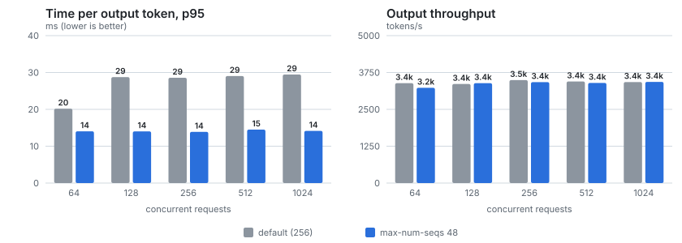

# 9. Stress test et réglage : `--max-num-seqs`

## Objectif

1. Pousser le serveur au-delà de sa capacité (64 à 1 024 requêtes simultanées) : où plafonne-t-il, et comment se
   dégrade-t-il ?
2. Diagnostiquer un problème avec les métriques serveur, le corriger avec **un seul paramètre**, et mesurer
   l'avant / après dans les mêmes conditions.

## Commandes

```bash
# 1. Stress test, réglages par défaut
bash bench/run.sh stress-default "64 128 256 512 1024" 4      # 7 936 requêtes, ~11 min
# 2. Réglage dans charts/ministral/values-gpu.yaml : --max-num-seqs 48, puis
cd terraform && terraform plan -out=tfplan && terraform apply tfplan
# 3. Exactement le même test
bash bench/run.sh stress-maxseqs48 "64 128 256 512 1024" 4
# 4. Comparaison
cd bench && python3 compare.py results/2026-11-13-stress-default results/2026-11-13-stress-maxseqs48 \
  "default (256)" "max-num-seqs 48" results/2026-11-13-maxseqs-comparison.svg
```

**Les deux outils :**

- `bench/server-metrics.sh` interroge Prometheus **sur la fenêtre exacte du Job** (`startTime` → `completionTime`) :
  pics de requêtes en cours et en attente, KV cache, préemptions, CPU du client et du serveur. Il écrit
  `server-metrics.json` à côté des résultats.
- `bench/compare.py` met deux runs côte à côte, niveau par niveau.

## Partie 1 : le stress test avec les réglages par défaut

| Concurrence | Requêtes (échecs) | Tokens/s | TTFT p50 / p95 | TPOT p50 / p95 | E2E p95 |
|---:|---:|---:|---:|---:|---:|
| 64 | 256 (0) | 3 388 | 0,4 / 1,0 s | 15,2 / 20,2 ms | 5,8 s |
| 128 | 512 (0) | 3 361 | 4,9 / 5,4 s | 17,0 / 28,8 ms | 10,3 s |
| 256 | 1 024 (0) | 3 491 | 13,7 / 14,5 s | 16,5 / 28,6 ms | 20,5 s |
| 512 | 2 048 (0) | 3 444 | 32,5 / 35,8 s | 16,9 / 29,0 ms | 40,3 s |
| 1 024 | 4 096 (0) | 3 427 | 70,1 / 73,8 s | 17,0 / 29,4 ms | 78,2 s |

**Lecture :**

- **Le débit plafonne dès 64** (~3 400 tokens/s) : le GPU est à sa capacité.
- **Au-delà, la latence absorbe tout.** Le TTFT croît linéairement avec la file. C'est la **loi de Little** :
  temps dans le système = requêtes présentes ÷ débit. Ici 1 024 ÷ 13,4 req/s ≈ 76 s, et on mesure E2E p50 = 75 s.
- **0 échec sur 7 936 requêtes** : vLLM met en file, il ne rejette pas.
- **Le client n'était pas le goulot d'étranglement** : 0,48 cœur CPU au maximum (Prometheus). Les mesures portent
  bien sur le serveur.

**Côté serveur (Prometheus) :**

| Métrique | Valeur |
|---|---:|
| requêtes servies en même temps (max) | **73** |
| requêtes en file (max) | 970 |
| KV cache (max) | **100 %** |
| préemptions | **~2 984** |

## Le diagnostic

- **La valeur par défaut :** pour un GPU de moins de 70 Go, vLLM v0.32.0 fixe `max_num_seqs = 256` (lu dans
  `vllm/engine/arg_utils.py`, `get_batch_defaults`).
- **Ce que le KV cache peut tenir :**
  - 40 384 tokens, en blocs de 16 tokens (`vllm:cache_config_info`), soit **2 524 blocs** ;
  - une requête du test = 512 + 256 tokens = **48 blocs** à pleine longueur ;
  - donc 2 524 ÷ 48 = **52 requêtes** tiennent ensemble à pleine longueur.
- **Pourquoi 73, puis des préemptions :**
  - À l'admission, une requête n'occupe que son prompt (32 blocs). vLLM en fait donc entrer ~73.
  - En générant, chacune grossit. Quand le cache est plein, vLLM **préempte** (éjecte) des requêtes en cours, qui
    devront refaire leur prefill plus tard : du calcul jeté.
- **Le réglage :** `--max-num-seqs 48`. On n'admet que ce qui tient à pleine longueur, avec ~8 % de marge.

**Hypothèses écrites avant le test :**

1. Préemptions ~3 000 → ~0.
2. TPOT p95 en nette baisse.
3. Débit stable, ou en légère hausse.
4. Contrepartie : un TTFT un peu plus haut à charge moyenne.

## Partie 2 : avant / après (seul `--max-num-seqs` change)



| Concurrence | Tokens/s | TPOT p50 (ms) | TPOT p95 (ms) | TPOT p99 (ms) | TTFT p50 (s) | E2E p50 (s) |
|---:|---:|---:|---:|---:|---:|---:|
| 64 | 3 388 → 3 231 (−5 %) | 15,2 → 13,5 | 20,2 → **14,0** (−30 %) | 23,0 → 14,1 | 0,4 → 0,4 | 4,4 → 3,9 |
| 128 | 3 361 → 3 388 (+1 %) | 17,0 → 13,6 | 28,8 → **14,0** (−51 %) | 30,6 → 14,2 | 4,9 → 6,8 | 9,2 → 10,0 |
| 256 | 3 491 → 3 423 (−2 %) | 16,5 → 13,4 | 28,6 → **13,9** (−51 %) | 30,4 → 14,0 | 13,7 → 14,5 | 18,0 → 17,9 |
| 512 | 3 444 → 3 396 (−1 %) | 16,9 → 13,6 | 29,0 → **14,5** (−50 %) | 30,7 → 14,6 | 32,5 → 35,0 | 36,9 → 38,6 |
| 1 024 | 3 427 → 3 432 (0 %) | 17,0 → 13,5 | 29,4 → **14,1** (−52 %) | 30,8 → 14,7 | 70,1 → 71,7 | 75,0 → 75,1 |

| Serveur (Prometheus) | défaut (256) | max-num-seqs 48 |
|---|---:|---:|
| requêtes servies en même temps (max) | 73 | 48 |
| requêtes en file (max) | 970 | 976 |
| KV cache (max) | 100 % | 82 % |
| **préemptions** | **2 984** | **0** |

**Les hypothèses face aux mesures :**

1. ✅ **Préemptions : 2 984 → 0.** Le KV cache ne dépasse plus 82 %.
2. ✅ **TPOT p95 divisé par deux** (~29 → ~14 ms), et le p99 aussi.
   - Surtout, **p50, p95 et p99 deviennent presque égaux** (13,5 / 14,1 / 14,7 ms) : chaque utilisateur reçoit ses
     tokens à un rythme régulier.
   - Avant, la queue de distribution était gonflée par les requêtes éjectées puis recalculées.
3. ➖ **Débit inchangé** (±5 %, dans le bruit d'un run unique). Les préemptions coûtaient de la régularité, pas du débit
   total : le GPU restait plein dans les deux cas.
4. ✅ **Le TTFT monte un peu à charge moyenne** (128 : 4,9 → 6,8 s ; 64 : p95 1,0 → 3,6 s). On admet 48 requêtes au
   lieu de ~73, donc plus de monde attend à la porte.
   - À saturation, rien ne change : même débit, donc même temps de file (loi de Little).

## Ce que ça m'apprend

- **Un réglage déplace un compromis, il ne crée pas de capacité.** Le débit est fixé par le GPU. `max-num-seqs`
  choisit **où** l'attente se produit :
  - **avant** de commencer : TTFT plus long ;
  - ou **pendant** la génération : tokens saccadés et calcul gaspillé.

  Pour un chat interactif, un flux régulier est souvent préférable. Pour du traitement par lots, seul le débit compte.
- **Pour faire baisser le TTFT sous surcharge, ce paramètre n'est pas le bon levier.** Il faut :
  - **plus de capacité :** réplicas, avec un autoscaling sur `vllm:num_requests_waiting` ;
  - **ou un contrôle d'admission :** répondre `429 Too Many Requests` au-delà d'une file maximale, plutôt que de faire
    attendre 70 s.
- **La méthode compte autant que le résultat :**
  - mesurer, diagnostiquer avec les métriques serveur, et **calculer** la valeur (pas la deviner) ;
  - écrire les hypothèses avant le test ;
  - ne changer qu'une variable, et refaire le même test.

**Les limites :**

- un seul run par configuration : un écart de ±5 % est du bruit ;
- une seule forme de trafic (512 → 256) : avec des requêtes plus longues, 48 serait trop ;
- le calcul suppose `max-model-len` 8 192 et cette forme de requête. En production, on dimensionne sur la distribution
  réelle des longueurs.

## Concepts

- **Préemption (vLLM).** Quand le KV cache manque de place, le scheduler retire des requêtes en cours pour libérer des
  blocs. En mode *recompute*, une requête préemptée refait son prefill quand elle revient.
- **`max_num_seqs`.** Le nombre maximal de séquences par itération : la taille du lot.
- **`max_num_batched_tokens`.** Le nombre maximal de tokens traités par itération (prefill + décodage, ici 2 048).
- **Loi de Little.** L = λ × W : requêtes présentes = débit × temps passé. À débit fixe, doubler la file double
  l'attente.
- **Système fermé et système ouvert.**
  - **Fermé** (`--max-concurrency`) : un nouveau client n'arrive que quand un autre a fini.
  - **Ouvert** (rafale, `--request-rate`) : les arrivées ne dépendent pas du serveur. La file peut croître sans limite,
    d'où la question de l'admission.

## Questions d'entretien

- **Un client se plaint d'un streaming saccadé sous charge. Que regardes-tu ?**
  1. `vllm:num_preemptions_total` et le KV cache. S'il y a des préemptions, le batch est trop gros pour le cache.
  2. Leviers : réduire `max-num-seqs`, réduire `max-model-len`, augmenter `gpu-memory-utilization`, quantifier le KV
     cache (fp8), ou ajouter du GPU.
  3. Mesurer le TPOT p95/p99 avant et après.
- **Le débit plafonne et le TTFT explose. Que proposes-tu ?**
  La capacité est atteinte, aucun paramètre ne la crée. Selon le besoin :
  - plus de réplicas, avec un autoscaling sur la file ;
  - un modèle plus petit ou quantifié ;
  - un contrôle d'admission (429) pour protéger la latence des requêtes acceptées ;
  - des priorités entre types de requêtes.
- **Comment as-tu choisi 48 ?**
  Par le calcul : 40 384 tokens ÷ 16 = 2 524 blocs, une requête de 768 tokens = 48 blocs, donc 52 requêtes à pleine
  longueur, moins une marge. Puis vérifié par la mesure : 0 préemption, KV cache à 82 %.
- **Pourquoi vLLM n'utilise-t-il pas cette valeur par défaut ?**
  Il ne connaît pas la longueur future des réponses. Admettre large maximise l'usage du cache dans le cas général, et
  les préemptions rattrapent l'excès. Le bon réglage dépend du trafic réel : c'est le travail d'intégration chez le
  client.
